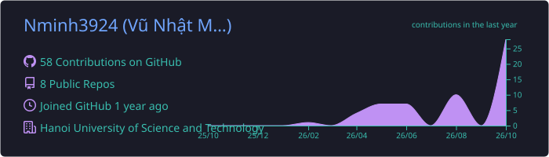

  

  
  
  

## 👨‍💻 About Me

Final-year Electronics & Telecommunications student at **Hanoi University of Science and Technology (HUST)**, researching **adversarial robustness of ADAS perception systems** and deploying deep learning models on embedded edge hardware.

- 🔭 Currently working on my thesis: attacking & defending vision models for autonomous driving
- 🚗 Interested in automotive AI, embedded perception, and ADAS research & engineering
- 🌏 Vietnamese (native) · English (professional) · Chinese (conversational)

## 🛠️ Tech Stack

  

  
  
  
  
  
  
  

## 🔬 Research & Projects

| Project | Description | Stack |
|---|---|---|
| **Adversarial Robustness in ADAS** *(thesis)* | FGSM, PGD and adversarial-patch attacks on road-sign & obstacle detection; defenses via adversarial training and input pre-filtering | PyTorch · RobustBench · OpenCV |
| **[Kalman State Prediction](https://github.com/Nminh3924/Kalman_state_pred)** | KF / EKF pipelines for target tracking and trajectory forecasting in automotive motion scenarios | C++ · Python · MATLAB |
| **Edge AI Deployment** | PyTorch → ONNX → TensorRT (FP16/INT8) on Jetson, streaming results over UART/CAN to a simulated vehicle ECU | C++ · TensorRT · Embedded Linux |

## 📊 GitHub Stats

  
  

  

  

  <picture>
    <source media="(prefers-color-scheme: dark)" srcset="https://raw.githubusercontent.com/Nminh3924/Nminh3924/output/github-snake-dark.svg"/>
    <source media="(prefers-color-scheme: light)" srcset="https://raw.githubusercontent.com/Nminh3924/Nminh3924/output/github-snake.svg"/>
    
  </picture>

